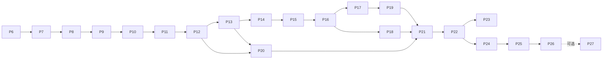

# Game Hub 发展路线图（总纲）

> 按阶段执行：先读本文件，再读当前 P 的任务卡。P1–P6 为第一轮已交付基线；P7–P16 为 2026-10-12 确认的第二轮改造；P17–P21 为 2026-10-15 确认的第三轮玩法规划。P17/P18 已实现并完成本轮真实 NAS 功能验收；P19–P21 本地已交付、待 NAS 上线。P22–P27 为 2026-10-16 确认的第四轮“街机角复兴”规划。任务卡描述目标；实现状态以各卡记录为准。

## 1. 产品定位与已确认决策

日麻为旗舰，16 个小游戏/棋牌为街机角。第二轮升级为**现代日式竞技馆风格的家庭日麻产品**。

| 维度 | 第二轮决策                                                                                                 |
| ---- | ---------------------------------------------------------------------------------------------------------- |
| 视觉 | 全站重设计；墨蓝、象牙白、少量朱红；保留八名角色与现有资产，采用 2D 牌桌                                   |
| 设备 | 电脑优先；手机可完整打牌，横屏优先、竖屏可操作                                                             |
| 服务 | 家庭局域网 NAS 服务；头像 + 4 位 PIN，设备可记住成员；不做邮箱注册与公网运营                               |
| 联机 | 家庭真人友谊局，1–4 名真人，空位 AI 补位；独立家庭战绩，不改变 AI 段位                                     |
| 离线 | 已打开并加载资源的成员自由局/小游戏可继续，恢复连接后同步；不保证断网后重新打开应用或打开未加载的游戏      |
| 数据 | NAS 保存成员权威档案；本地单机保留；旧存档显式迁移，禁止静默覆盖                                           |
| 续局 | 同一成员不同设备的未完成自由局分别保留，自选继续；在线段位和真人牌桌各限制一场活动对局，且二者不得同时进行 |
| 掉线 | 60 秒宽限后 AI 托管；宽限期内正常超时默认操作；重连在下一决策点接手；全真人离线保存并暂停                  |
| 内容 | 小规模主题挑战、八名角色短故事、收藏目标；不新增角色、小游戏、语音、抽卡                                   |
| 顺序 | 可靠性 → 新视觉/手感 → 成员服务/同步/联机 → AI/训练/内容                                                   |

P1–P6 的“纯本地、禁止后端/账号/联机、移动端不专门改造、深绿暖木主题”是**第一轮历史边界**。第二轮以上表为准；旧任务卡不回写为新需求，完成记录保留。

### 第三轮方向：让已建成的日麻与家庭牌桌更值得反复打开

- 第一批并行推进 **P17 雀庄巡礼试点**与 **P18 牌谱重打**。前者提供可重试的角色挑战，后者让已有牌谱中的关键决策变成可继续打完的练习；两者都复用现有日麻规则，不产生 AI 段位分或可重复刷取的经济奖励。
- P17 的试点先使用已存在的葵、凛、澪。只有在目标可理解、重复游玩有不同决策空间、用户愿意主动再开局后，P19 才扩成九名现有角色的巡礼第一季，并考虑加入**一名**新对手。新角色是第三轮计划；上表“不新增角色”仅为第二轮边界。
- P20 用现有家庭桌做多场制家庭雀庄杯；P12/P13 的真实 NAS 多客户端整场与恢复已于 10-15 验证，实体家庭设备体验另记；杯赛数据由 NAS 独立、幂等地记账。P21 再将已验证的巡礼与家庭杯整理为可回访的精选轮换，不强迫每日登录，不让旧内容过期消失。
- 单人巡礼、牌谱练习与家庭杯的进度、来源和奖励分别定义；不得伪装成现有 `free` / `ai-ranked` / `family` 结算来源。需要扩展共享契约时，先统一更新本节及前后端/Mock，再实现入口与落盘。

### 第四轮方向：街机角复兴——让 16 个小游戏成为家人之间的事

2026-10-16 通过访谈确认。先用 P22 收尾第三轮并稳定 NAS 基线，再做两条线：**家庭排行榜**（P23）与**家人真人对战**（P24–P26）。

| 维度     | 第四轮决策                                                                                                                         |
| -------- | ---------------------------------------------------------------------------------------------------------------------------------- |
| 收尾     | P22 先完成 P19–P21 NAS 部署与现场验收；第 10 名角色为独立子项，开工前另行访谈定稿，不阻塞街机阶段                                  |
| 排行榜   | 每个“游戏 × 难度”有历史最佳与本周最佳；周一 00:00（Asia/Shanghai）切换；只计成员；指标与个人最佳一致                              |
| 荣誉     | 周冠军徽记/称号 + 家庭动态，**不发雀币**；该榜本周至少 2 名成员有成绩才颁发；已结算周不回溯改判                                     |
| 防作弊   | 信任家人：补齐 16 个游戏服务端合理性校验 + 管理 CLI 隐藏/恢复异常成绩；不做重放验算                                                |
| 房间架构 | 新建通用房间内核 + 游戏适配器；日麻房间本轮不动，P27 视 NAS 验收结果可选迁移                                                       |
| 对战游戏 | 五子棋（验证内核）→ 中国象棋 → 斗地主；升级、围棋、国际象棋、井字棋、实时动作类本轮不做                                            |
| 限时掉线 | 棋类默认不限时（房主可选局时），掉线即暂停不托管，暂停 10 分钟后可“结束对局（不计胜负）”，24 小时自动作废；斗地主沿用日麻每步限时 + 60 秒托管 |
| 协商     | 棋类支持认输、提和、悔棋请求（对方同意，房主可关闭/限次）                                                                         |
| 结算     | 新来源 `family-arcade`；≥2 真人完赛发街机单局公式雀币，与家庭日麻共享每日 200 上限；不计个人 vs AI 连胜/成就/排行榜               |
| 战绩     | 家人对线表（按游戏的两两胜/负/和），不做等级分                                                                                     |
| 入口     | 统一家庭大厅加游戏筛选；街机游戏页加“邀家人对战”；**全局一人一局**（日麻房间、段位局、对战房间互斥，观战不算）                     |
| 观战     | 仅棋类（象棋、五子棋）只读观战；斗地主/日麻观战不做                                                                              |
| 斗地主   | 真人局加叫分（1/2/3 或不叫，全不叫重发）；引擎改为座位无关，旧单人 API 兼容；单人默认保持随机地主                                  |

## 2. 阶段总览与依赖

| 阶段 | 名称                                   | 状态                                               | 任务卡                             |
| ---- | -------------------------------------- | -------------------------------------------------- | ---------------------------------- |
| P1   | 地基：主题、大厅、事件总线、雀币、存档 | 已完成                                             | [P1](./P1-foundation.md)           |
| P2   | 八名角色、风格与台词                   | 已完成                                             | [P2](./P2-characters.md)           |
| P3   | AI 段位战、四档 AI                     | 已完成                                             | [P3](./P3-ranked.md)               |
| P4   | 局内演出、终局复盘、闲聊               | 已完成                                             | [P4](./P4-presentation.md)         |
| P5   | 商店、外观、好感故事                   | 已完成                                             | [P5](./P5-shop-affinity.md)        |
| P6   | 副玩法统一与成长循环                   | 已完成                                             | [P6](./P6-arcade.md)               |
| P7   | 使用可靠性与发布准备                   | NAS 发布、资源、深链及隔离站手动/失败回退通过 | [P7](./P7-reliability.md)          |
| P8   | 全站视觉重设计                         | 正式 NAS 桌面/手机视口巡检通过 | [P8](./P8-visual-redesign.md)      |
| P9   | 牌桌交互与视听品质                     | NAS 页面闭环通过；实体手机音频/触控待体验 | [P9](./P9-table-experience.md)     |
| P10  | 家庭成员与 NAS 服务                    | NAS 成员、迁移、购买、防重及数据保留通过 | [P10](./P10-household-service.md) |
| P11  | 跨设备续玩与离线同步                   | NAS 跨设备身份续局/离线同步通过；实体网络体验另记 | [P11](./P11-save-sync.md)          |
| P12  | 家庭真人牌桌                           | NAS 双成员整场、WS、视角/奖励隔离通过 | [P12](./P12-family-multiplayer.md) |
| P13  | 重连、托管与恢复                       | NAS 68 秒托管、SIGKILL/WAL 恢复、防重通过 | [P13](./P13-reconnect-autoplay.md) |
| P14  | AI 与竞技可信度                        | NAS 并发半庄/段位及四档 AI 性能通过 | [P14](./P14-ai-ranked-quality.md)  |
| P15  | 牌谱档案与训练闭环                     | NAS 牌谱权限、训练及手机视口通过 | [P15](./P15-replay-training.md)    |
| P16  | 挑战、故事与收藏目标                   | 最新版已发布；NAS 三挑战/故事解锁与防重通过 | [P16](./P16-challenges-stories.md) |
| P17  | 雀庄巡礼试点                           | NAS 三关/跨设备与整局重试通过；待玩家反馈 | [P17](./P17-venue-journey.md)       |
| P18  | 牌谱重打                               | NAS 本人牌谱分支终局/隔离与手机结果页通过 | [P18](./P18-replay-branch.md)        |
| P19  | 雀庄巡礼第一季                         | 本地非 NAS 端已交付（含全部 10 关与第 10 人椿）；待 NAS 部署 | [P19](./P19-character-season.md)    |
| P20  | 家庭雀庄杯                             | 本地非 NAS 端已交付；待 NAS 部署与实体多机体验 | [P20](./P20-family-cup.md)          |
| P21  | 精选轮换与回访                         | 本地非 NAS 端已交付；待 NAS 部署与轮换体验     | [P21](./P21-curated-rotation.md)    |
| P22  | 第三轮收尾：P19–P21 NAS 上线与第 10 人 | 本地非 NAS 项已全部完成（迁移演练 + 22.3 第 10 人椿）；仅待 NAS 部署/现场验收 | [P22](./P22-round3-closeout.md)     |
| P23  | 家庭排行榜与动态                       | 本地非 NAS 端已全部交付（服务端 + 前端界面 + CLI）；待 NAS 部署验收 | [P23](./P23-family-leaderboard.md)  |
| P24  | 通用房间内核 + 五子棋对战              | 本地实现与双成员整局核对完成；边界回归及 NAS 待验 | [P24](./P24-room-kernel-gomoku.md)  |
| P25  | 中国象棋对战（提和/悔棋/局时/观战）    | 本地实现与基础流程核对完成；边界回归及 NAS 待验 | [P25](./P25-xiangqi-battle.md)      |
| P26  | 斗地主对战（暗牌/叫分/托管）           | 本地实现与三成员整局核对完成；完整边界及 NAS 待验 | [P26](./P26-doudizhu-battle.md)     |
| P27  | 日麻房间迁移至通用内核（可选）         | 待 P24–P26 NAS 验收后决定                          | [P27](./P27-riichi-room-migration.md) |



每个阶段独立交付。P7–P9 交付新版单机；P10–P13 交付家庭服务；P14–P16 深化游玩。第三轮 P17/P18 可并行；P19 取决于 P17 试点结果，P20 取决于家庭桌现场验收，P21 汇总已验证的玩法。第四轮 P22 先行（第 10 人子项除外）；P23 与 P24 可并行；对战按 P24 → P25 → P26 逐步加难；P27 仅在 P24–P26 NAS 验收通过且用户确认后开工。阶段内可拆小批，但未满足各卡入口条件不得把后续阶段标为已完成。

## 3. 仓库与部署路径

仓库路径：Mac `/Users/liangshuai/mdd_work/game-hub`，Windows `F:\CodeWork\game\game-hub`。任务卡现有文件用相对 Markdown 链接，新增文件用代码路径并标注“计划新增”，避免死链接被当成现有实现。

| 路径                                             | 职责 / 状态                                                        |
| ------------------------------------------------ | ------------------------------------------------------------------ |
| `src/`                                           | 已有 React 19、Rsbuild、Tailwind v4、shadcn/ui、Zustand 前端       |
| `src/pages/mahjong/japanese/engine/`             | 已有日麻规则/AI；服务端复用同一内核，禁止复制第二套规则            |
| `server/`                                        | Node 24、Fastify、SQLite 家庭服务，与前端共享业务规则               |
| `shared/contracts/`                              | 已有成员通信类型，不导入 DOM、React、浏览器持久化                  |
| `deploy/nas/`                                    | P7 新增静态发布准备；P10 扩为前端 + 服务端容器                     |
| `scripts/deploy-to-nas.ps1`                      | 已有 Windows 部署入口；第二轮加入校验与回滚                        |
| `/volume1/docker/game-hub/site/`                 | 旧静态副本，保留作回退参考                                         |
| `/volume1/docker/game-hub/releases/<releaseId>/` | 不可变静态版本；当前为 `nas-closeout-20261015d`                         |
| `/volume1/docker/game-hub/assets/`               | 跨版本哈希资源目录，供已打开的旧页面继续加载                       |
| `/volume1/docker/game-hub/current`               | 活动版本符号链接；Nginx 只读挂载父目录                             |
| `/volume1/docker/game-hub/data/`                 | SQLite 成员数据库与备份持久卷                                      |

当前 NAS 地址为 [Game Hub](http://192.168.50.21:8089/)，SSH 别名为 `synology-nas`；[家庭入口](http://192.168.50.21:8088/) 可直接进入。2026-10-15 已发布 `nas-closeout-20261015d`（代码 `fe79089`），前一静态版本 `p16-nas-20261014c`；前后端健康、165 资源散列、深链、WASM、成员业务、同步、家庭整场与恢复、AI、牌谱、P16–P18 均有实际证据。两名正式成员快照/版本与发布前完全一致。

完整证据、备份、回退和设备边界以[NAS 收尾验收记录](./NAS-ACCEPTANCE-2026-10-15.md)为准。自动化多设备使用独立客户端/deviceId；实体手机音频/触控/锁屏与 Wi-Fi 体验尚未替代，P17 扩张等待玩家反馈。本轮不生成 EXE、不开始 P19–P21。

## 4. 跨阶段统一契约（唯一来源）

### 4.1 模式、成员与数据归属

- `guest-local`：现有独立浏览器单机；不自动归入任何成员，也不把游客增长自动上传。
- `member-online`：NAS 为权威数据源；客户端缓存已确认档案，使用版本化 API。
- `member-offline`：仅此前成功登录并缓存档案的设备可用；已加载的自由局/小游戏继续游玩，待确认奖励单独显示。
- `memberId`、`deviceId`、`matchId`、`eventId` 均为 UUID 字符串；UUID 必须兼容局域网 HTTP。服务端以会话认定成员与设备，不信任请求自报身份。
- `matchSource = 'free' | 'ai-ranked' | 'family' | 'arcade' | 'family-arcade'`；统计和结算保留来源，AI 段位仅接受 `ai-ranked`。`family-arcade` 为家人街机对战的独立在线来源，不接受离线上报，见 4.7。
- 首次迁移只能把一个完整旧本地存档导入空成员一次。导入前下载备份，服务端校验各业务字段，提交成功才标记已迁移；其他设备的旧存档不自动合并。

### 4.2 成员档案、同步与存档

- `MemberSnapshot` 使用 `schema: 1`、递增 `revision`、服务端 `updatedAt`，包含 profile、growth、characters、wallet、cosmetics、achievements、arcade、stats、dailyTasks、weeklyTasks、checkin、preferences。类型复用各业务的持久化结构，不包含函数。
- `ResumeSave`：`schema: 1, memberId, deviceId, saveId, source: 'free', updatedAt, replay, processedProgress`；按 `deviceId + saveId` 保留多份，用户选择恢复，禁止全档覆盖。
- 离线凭据：`schema: 1, eventId, memberId, deviceId, matchId, matchSource, occurredAt, payload`。日麻 payload 含可重放的完整自由局牌谱；街机含游戏、难度、结果和指标。拒绝离线上报段位局、真人局、消费及领取任务奖。
- `POST /api/v1/sync` 接收 `baseRevision` 和凭据批次，返回 accepted、duplicates、rejected（逐条 id/code）及最新 snapshot。SQLite 以 `(memberId, eventId)` 和结算 `(memberId, matchId, source)` 唯一约束防重，不用截断的前端最近 ID 列表作唯一依据。
- 成长/胜场逐对局累计，最佳取 max/min，解锁集合并集；不得把余额、总胜场、段位 pt 当增量直接相加。服务端从已接受凭据计算奖励。
- 离线游玩不领取签到、每日/每周任务奖，不追补到期任务；基础奖励按服务端接收当天（Asia/Shanghai）上限结算，客户端提示待确认不等于到账。
- 设置与装备采用 revision 控制，409 时重取新档案并只重放本次用户改动。购买在线执行、事务提交，余额不得为负。
- P7 恢复备份仍为 schema 1，带 `recovery.partial/pendingCount`；partial=true 的备份只能作人工恢复资料，所有覆盖导入与成员迁移入口均须拒绝。
- 既有 schema 1 JSON 导出保持可读；P10/P11 新成员备份带新的 `schema: 2` 与归属信息，禁止将成员备份通过旧游客导入路径直接覆盖服务器。

### 4.3 服务 API 与认证

- HTTP 同域 `/api/v1`，WebSocket `/ws`；生产由 Nginx 反代，开发使用代理，前端不硬编码 NAS IP。
- API：`GET /healthz`；`GET /api/v1/members` 只返回 id/昵称/头像；`POST /api/v1/session` 验证 PIN；`DELETE /api/v1/session` 退出；`GET /api/v1/me` 取档案；`PATCH /api/v1/me/preferences` 修改指定偏好；`POST /api/v1/me/import` 一次性迁移；`POST /api/v1/shop/purchases` 事务购买；同步接口见 4.2。
- PIN 4 位数字，服务端加盐哈希；同成员/IP 连错五次等待五分钟。会话使用 HttpOnly、SameSite=Strict Cookie，记住设备有效期 30 天；HTTP 局域网下 Secure=false，未来 HTTPS 再启用。变更请求校验同源 Origin，WebSocket 同样校验会话及 Origin。
- 成员创建与 PIN 重置由 NAS 本地管理 CLI 完成，不开放匿名管理接口。不引入邮箱、第三方 OAuth、Redis 或公网用户注册。
- HTTP 错误统一 `{ code, messageKey, retryable, revision? }`；不得发送堆栈、PIN 哈希或数据库内部路径到客户端。

### 4.4 房间、牌局与隐藏信息

- 房间支持 1–4 真人；空位 AI 补齐。1 真人 + AI 可体验房间，但不发家庭奖励。房主在等待室设置东风/半庄、AI 档位、准备和开始；开局后规则固定。
- `Room` 使用 schema 1、UUID id、revision、`waiting | playing | paused | finished`，座位记录真人 memberId 或 AI characterId。HTTP `/api/v1/rooms` 列表/创建，WebSocket 入座、准备、开始、操作与重连。
- 客户端命令统一 `{ protocol: 1, commandId, roomId, matchId?, expectedRevision, type, payload }`。服务端校验本人座位、控制设备、合法操作、当前版本；重复 commandId 返回同一结果，过期操作拒绝并返回最新玩家快照。
- 服务端事件为 `room`, `match`, `ack`, `error`；ack 含 commandId、accepted/rejected、code、revision。match 含 viewerSeat、本人合法操作、公共场况与服务器截止时间。
- 完整规则状态保留在 NAS；客户端只拿本人手牌、他家手牌张数、牌河、副露、点数、场况。其他人的动作选项、未结算响应、牌山、里宝、seed、全知牌谱不下发。完整牌谱仅整场终局后开放给参赛成员。
- 服务端串行处理每桌命令，AI/超时/下一局推进只在服务器执行。客户端菜单与演出不暂停整桌；计时以服务器 deadline 为准。
- 成员可多设备登录，但同一在线活动局只有一个控制设备。切换设备需明确接管，旧设备变只读，不能重复行动。

### 4.5 奖励、托管与归档

- 家庭局独立战绩，不改 AI 段位 pt。家庭基础雀币沿用自由局公式，不乘段位加成，每人每日上限 200；至少两真人开局、完成整场且本人未主动退出才发奖。单成员/整场只结算一次。
- 自己主角色的完赛好感沿用自由局规则；真人对手不计作虚拟角色相遇/对战统计。全程未自行操作的托管席只记战绩不发成长奖励。
- 掉线 60 秒后托管，宽限期间沿用超时默认操作。重连在下个决策点接管；全真人离线立即持久化并暂停，重新连接后恢复。房主掉线不解散进行中牌桌。
- 归档保留每成员最近 200 场，收藏最多 100 场且不受普通淘汰影响；删除牌谱不删除已结算凭据/成长，不允许刷奖励。

### 4.6 第三轮玩法边界（P17/P18 已实现，P19–P21 规划）

- P17 的巡礼关卡使用合法可重放的日麻状态与现有引擎。关卡进度、最佳记录与一次性内容解锁独立记录；重试不反复发雀币、成长、好感或段位分。若需要新的对局来源，先更新 4.1 的来源枚举和真实/Mock 结算链，不以既有来源冒名入账。
- P18 从**已结束、本人有权查看**的牌谱与 P15 关键决策进入隔离练习。分支从原始重放的同一时点继续，原牌谱只读；分支结果不写入原牌谱、成员经济、角色成长、P16 挑战或战绩。结论同时展示当时可见信息与结果差异，不把一次随机结果当成最优选择证明。家庭牌谱的分支入口须先通过本人视角与隐藏信息验收。
- P20 的杯赛成绩由服务端依据多场家庭桌最终结算单独记账，唯一键防重，不能从可删除的牌谱列表推导。真实多设备、断线托管和服务重启恢复未验收前，只做本机设计与隔离开发，不开放正式杯赛奖励。
- P21 的轮换只引用仍可玩的既有内容；配置、解锁与已完成记录需版本化并兼容旧成员档案。人工切换/应用发布不重置历史最佳，不增加强制签到、过期惩罚或付费赛季。

### 4.7 第四轮边界（P22–P27 规划）

- **排行榜（P23）**：只读聚合服务端已接受的成员街机成绩（在线 `arcade_rounds` + 已接受离线凭据），口径与 `getBestValue` 一致；不进入任何经济结算。周冠军唯一键 `(weekId, gameId, difficulty, memberId)`，惰性结算、不回溯。被管理 CLI 隐藏的成绩只退出榜单，不回收已发奖励。
- **通用房间内核（P24）**：协议 `shared/contracts/gameRoom.ts` 沿用 4.4 命令信封、幂等、revision、私有视角与服务端 deadline 原则；REST `/api/v1/game-rooms`，`/ws` 复用连接与认证，以 `subscribe_game_room` / `game_command` 区分街机消息。现有日麻房间协议与行为在 P27 之前不得改变。
- **`family-arcade` 结算**：≥2 真人完赛且本人未主动退出才发奖；认输视为完赛告负；“结束对局（不计胜负）”与 24 小时作废不发奖、不计对线表。使用街机单局公式，与 4.5 家庭日麻共享每人每日 200 上限，唯一键 `(memberId, matchId, source)`。不计个人 vs AI 统计、成就与排行榜；不接受离线上报。
- **全局一人一局**：同一成员同一时刻最多一个进行中的在线对局（日麻家庭房间、AI 段位局、对战房间之一）；棋类观战不计入。
- **隐藏信息**：斗地主等暗牌游戏沿用 4.4 规则——他人手牌、未公开底牌、seed 与 AI 内部状态不下发；暗牌游戏不开放观战。

## 5. 全局工程与验收约定

- 中文/英文文案走 [i18n.ts](../../src/lib/i18n.ts)；新持久化结构版本化并 normalize，迁移不得丢原有角色、成就、段位、雀币、外观或牌局。
- 前端现有技术栈不换。P10 先通过 Node/WASM 装载与现有引擎复用门禁，再做房间上层；失败先解决适配，禁止临时复制规则或广播全知状态。
- 每阶段先检查真实仓库/分支/已有改动。小批完成；不做无关重构、不覆盖他人改动。
- 类型检查 `pnpm typecheck`，样式/静态检查限定改动文件，构建 `pnpm build`。`pnpm check` 会全仓自动格式化，谨慎使用，不把无关格式化混入阶段改动。
- 不另建大测试体系。按当前授权运行直接相关现有检查和任务卡浏览器验收；截图/故障注入用隔离浏览器，不能修改用户实际存档。
- 任务卡分别记录 NAS 部署/健康检查和真实设备功能验收；部署成功不代表玩法已通过。每项完成状态都写明现场证据；NAS 不可达时只能完成本机验收。
- 真实 NAS 发布须先核对挂载、权限、端口和 CPU 架构，并检查备份、回滚；提交、推送、发布、外部上传只有明确要求时执行。

## 6. 交接提示词

```text
你在 /Users/liangshuai/mdd_work/game-hub 工作。先读 docs/roadmap/README.md 和当前 P 的任务卡，
再读“涉及文件”。遵守总纲统一契约，现有路径须核实，计划新增路径不是已有代码。
仅实施当前阶段，保留用户数据与其他人的改动。按任务卡逐项验收，区分本机结果与真实 NAS 待验项。
NAS 暂不可达时继续本地开发，不自行部署、提交或推送。更新当前任务卡状态和验收证据。
```
