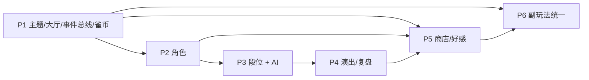

# Game Hub 发展路线图（总纲）

> 本目录是交给执行方（GPT / 其他 Agent）的开发说明。**按阶段逐个投喂**：每次只给本文件 + 当前阶段的任务卡。
> 范围只涉及 **玩法 / 功能拓展 / UI**，不涉及测试体系建设。

## 1. 产品定位

**日麻为旗舰，其余游戏为副玩法（"雀庄里的街机角"）。**

- 主线：日麻段位战 + 角色对手 + 雀币/外观收集 + 角色好感故事。
- 副线：16 个小游戏/棋牌接入统一成长循环（任务、成就、雀币），只打磨不新增。
- 纯单机、纯本地（localStorage），桌面优先。

## 2. 已确定的决策（不要再改）

| # | 维度 | 决策 |
|---|------|------|
| 1 | 定位 | 日麻旗舰，其余游戏为副玩法并接入统一成长体系 |
| 2 | 日麻核心循环 | 段位天梯（升降段 + pt） |
| 3 | 角色定位 | 角色 = AI 对手，有打法风格与台词；段位战对手从角色池抽取 |
| 4 | 角色规模/美术 | 8 名角色；AI 生成立绘（半身 + 3 表情：常态/开心/懊恼）；只有文字气泡，无语音 |
| 5 | 经济 | 新增软货币「雀币」；外观商店（牌背/桌布/立直棒特效/和牌特效/头像框）；角色靠段位+好感解锁，不可购买 |
| 6 | 副玩法接入 | 统一事件总线：start / finish / win / best → 任务、成就、雀币；副玩法雀币产出低于日麻 |
| 7 | 游戏库 | 只打磨不新增：全部套统一 GameShell + 难度 + 个人最佳 |
| 8 | UI 风格 | 「日式雀庄」：深绿毡 + 暖木 + 金色点缀，纸质感圆角卡片；首页改为「大厅」 |
| 9 | 平台 | 桌面优先，移动端可用即可 |
| 10 | 数据 | 纯本地 + 存档 JSON 导出/导入；不做后端、不做联机 |
| 11 | 局内演出 | 角色 Cut-in、和牌演出升级、终局复盘、牌桌闲聊 |
| 12 | 段位结构 | 5 段 × 3 级；东风/半庄均可（半庄 pt ×1.5）；AI 扩为 4 档 beginner/standard/strong/expert |
| 13 | 好感 | 对战/设为主角色获得；各阶段依次解锁小故事 → 新表情台词 → 专属外观；角色档案页时间线 |
| 14 | 顺序 | P1 → P2 → P3 → P4 → P5 → P6，严格按依赖推进 |

## 3. 阶段总览

| 阶段 | 名称 | 交付后玩家能感知到什么 | 任务卡 |
|------|------|------------------------|--------|
| P1 | 地基：雀庄主题 + 大厅 + 事件总线/雀币/存档 | 整站换成雀庄风格，首页是大厅，打完日麻能拿雀币，可导出存档 | [P1](./P1-foundation.md) |
| P2 | 8 名角色 | 对手有名字、头像、打法风格；立直/和牌有 Cut-in 和台词 | [P2](./P2-characters.md) |
| P3 | 段位战 + 4 档 AI | 大厅可开段位战，有升降段、pt 结算、战绩 | [P3](./P3-ranked.md) |
| P4 | 局内演出 | 和牌逐条役种演出、满贯以上特效、终局复盘、闲聊气泡 | [P4](./P4-presentation.md) |
| P5 | 商店 + 好感故事 | 雀币可以买牌背桌布等并装备；角色档案页与好感故事 | [P5](./P5-shop-affinity.md) |
| P6 | 副玩法统一 | 所有小游戏统一外壳、难度、个人最佳，接入任务/成就/雀币 | [P6](./P6-arcade.md) |



## 4. 全局约定（每个阶段都适用）

**技术栈**：沿用现有 React 19 + rsbuild + Tailwind v4 + shadcn/ui + zustand + three.js。不引入新的 UI 框架或状态库。

**国际化**：所有新增文案必须走 `src/lib/i18n.ts`，同时补 `zh` 与 `en`。角色台词、故事同样走 i18n key。

**存储**：
- 新增 localStorage key 一律 `game-hub-` 前缀，结构带版本号（如 `game-hub-ranked-v1`）。
- 读取时必须做 normalize（参考 [growth.ts](../../src/lib/growth.ts) 的 `normalizeGrowthState`），老数据缺字段不能崩。
- 不得破坏已有玩家数据（成就、成长点、称号、角色解锁、日麻存档）。

**代码风格**：
- 纯逻辑放 `src/lib/`（或日麻的 `engine/`），组件只做展示与交互。
- 保留现有注释与文档；不做与本阶段无关的重构。
- 美术资源放 `src/assets/`，优先 webp。

**完成标准**：
- `pnpm check`（typecheck + biome）通过，`pnpm build` 通过。
- **不要求新增测试**。已有测试若因预期行为变化而失败，更新断言即可，不要为了测试而改设计。
- 每阶段结束在 `pnpm dev` 下按任务卡「验收」逐条手动走一遍。

**全局不做**：后端/账号/云存档/联机、语音、抽卡、新增小游戏、移动端专属布局、大规模测试补齐。

## 5. 如何投喂给 GPT

每个阶段一次对话，提示词模板：

```
你在仓库 game-hub 中工作。请先完整阅读 docs/roadmap/README.md 与 docs/roadmap/P{N}-xxx.md，
再阅读任务卡「涉及文件」中列出的现有代码，然后实现该阶段。
严格遵守「不做」清单；遇到任务卡没覆盖的设计细节，选择最简单且与总纲一致的方案，并在最后列出你做的假设。
完成后运行 pnpm check 与 pnpm build，并按「验收」逐条说明结果。
```

阶段较大时（P2、P3、P4）可按任务卡里的子任务编号分 2–3 次对话执行。
