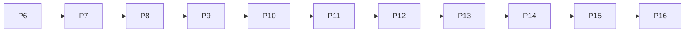

# Game Hub 发展路线图（总纲）

> 按阶段执行：先读本文件，再读当前 P 的任务卡。P1–P6 为第一轮已交付基线；P7–P16 为 2026-10-12 确认的第二轮改造。任务卡描述目标；实现状态以各卡验收记录为准。

## 1. 产品定位与已确认决策

日麻为旗舰，16 个小游戏/棋牌为街机角。第二轮升级为**现代日式竞技馆风格的家庭日麻产品**。

| 维度 | 第二轮决策 |
|---|---|
| 视觉 | 全站重设计；墨蓝、象牙白、少量朱红；保留八名角色与现有资产，采用 2D 牌桌 |
| 设备 | 电脑优先；手机可完整打牌，横屏优先、竖屏可操作 |
| 服务 | 家庭局域网 NAS 服务；头像 + 4 位 PIN，设备可记住成员；不做邮箱注册与公网运营 |
| 联机 | 家庭真人友谊局，1–4 名真人，空位 AI 补位；独立家庭战绩，不改变 AI 段位 |
| 离线 | 已打开并加载资源的成员自由局/小游戏可继续，恢复连接后同步；不保证断网后重新打开应用或打开未加载的游戏 |
| 数据 | NAS 保存成员权威档案；本地单机保留；旧存档显式迁移，禁止静默覆盖 |
| 续局 | 同一成员不同设备的未完成自由局分别保留，自选继续；在线段位和真人牌桌各限制一场活动对局，且二者不得同时进行 |
| 掉线 | 60 秒宽限后 AI 托管；宽限期内正常超时默认操作；重连在下一决策点接手；全真人离线保存并暂停 |
| 内容 | 小规模主题挑战、八名角色短故事、收藏目标；不新增角色、小游戏、语音、抽卡 |
| 顺序 | 可靠性 → 新视觉/手感 → 成员服务/同步/联机 → AI/训练/内容 |

P1–P6 的“纯本地、禁止后端/账号/联机、移动端不专门改造、深绿暖木主题”是**第一轮历史边界**。第二轮以上表为准；旧任务卡不回写为新需求，完成记录保留。

## 2. 阶段总览与依赖

| 阶段 | 名称 | 状态 | 任务卡 |
|---|---|---|---|
| P1 | 地基：主题、大厅、事件总线、雀币、存档 | 已完成 | [P1](./P1-foundation.md) |
| P2 | 八名角色、风格与台词 | 已完成 | [P2](./P2-characters.md) |
| P3 | AI 段位战、四档 AI | 已完成 | [P3](./P3-ranked.md) |
| P4 | 局内演出、终局复盘、闲聊 | 已完成 | [P4](./P4-presentation.md) |
| P5 | 商店、外观、好感故事 | 已完成 | [P5](./P5-shop-affinity.md) |
| P6 | 副玩法统一与成长循环 | 已完成 | [P6](./P6-arcade.md) |
| P7 | 使用可靠性与发布准备 | 本机完成；NAS/容器/Windows待验 | [P7](./P7-reliability.md) |
| P8 | 全站视觉重设计 | 待实施 | [P8](./P8-visual-redesign.md) |
| P9 | 牌桌交互与视听品质 | 待实施 | [P9](./P9-table-experience.md) |
| P10 | 家庭成员与 NAS 服务 | 待实施 | [P10](./P10-household-service.md) |
| P11 | 跨设备续玩与离线同步 | 待实施 | [P11](./P11-save-sync.md) |
| P12 | 家庭真人牌桌 | 待实施 | [P12](./P12-family-multiplayer.md) |
| P13 | 重连、托管与恢复 | 待实施 | [P13](./P13-reconnect-autoplay.md) |
| P14 | AI 与竞技可信度 | 待实施 | [P14](./P14-ai-ranked-quality.md) |
| P15 | 牌谱档案与训练闭环 | 待实施 | [P15](./P15-replay-training.md) |
| P16 | 挑战、故事与收藏目标 | 待实施 | [P16](./P16-challenges-stories.md) |



每个阶段独立交付。P7–P9 先交付新版单机；P10–P13 交付家庭服务；P14–P16 深化游玩。阶段内可拆小批，但未满足入口条件不得提前实现下一阶段。

## 3. 仓库与部署路径

仓库绝对路径：`/Users/liangshuai/mdd_work/game-hub`。任务卡现有文件用相对 Markdown 链接，新增文件用代码路径并标注“计划新增”，避免死链接被当成现有实现。

| 路径 | 职责 / 状态 |
|---|---|
| `src/` | 已有 React 19、Rsbuild、Tailwind v4、shadcn/ui、Zustand 前端 |
| `src/pages/mahjong/japanese/engine/` | 已有日麻规则/AI；服务端复用同一内核，禁止复制第二套规则 |
| `server/` | P10 计划新增：Node 24 LTS、Fastify、SQLite 家庭服务 |
| `shared/contracts/` | P10 计划新增：纯通信类型，不导入 DOM、React、浏览器持久化 |
| `deploy/nas/` | P7 新增静态发布准备；P10 扩为前端 + 服务端容器 |
| `scripts/deploy-to-nas.ps1` | 已有 Windows 部署入口；第二轮加入校验与回滚 |
| `/volume1/docker/game-hub/site/` | 已知 NAS 历史静态目录；不是已核对的容器挂载 |
| `/volume1/docker/game-hub/releases/<releaseId>/` | 拟用不可变静态版本目录 |
| `/volume1/docker/game-hub/assets/` | 拟用跨版本哈希资源目录，保证已打开旧页面仍可加载资源；P7不自动清理 |
| `/volume1/docker/game-hub/current` | 拟用活动版本符号链接；容器须挂载父目录才能看见切换 |
| `/volume1/docker/game-hub/data/` | P10 拟用数据库、恢复记录、备份持久卷；不得放入静态网站目录 |

当前 NAS 地址 `http://192.168.50.21:8089`，SSH 别名 `synology-nas`。NAS 无外网访问，当前环境不可达。容器挂载、端口占用、CPU 架构、权限、反向代理均**待现场核对**；不得假定现有挂载支持切换，也不得擅自替换容器。计划配置通过本地容器验证后，真实部署仍需明确授权。

## 4. 跨阶段统一契约（唯一来源）

### 4.1 模式、成员与数据归属

- `guest-local`：现有独立浏览器单机；不自动归入任何成员，也不把游客增长自动上传。
- `member-online`：NAS 为权威数据源；客户端缓存已确认档案，使用版本化 API。
- `member-offline`：仅此前成功登录并缓存档案的设备可用；已加载的自由局/小游戏继续游玩，待确认奖励单独显示。
- `memberId`、`deviceId`、`matchId`、`eventId` 均为 UUID 字符串；UUID 必须兼容局域网 HTTP。服务端以会话认定成员与设备，不信任请求自报身份。
- `matchSource = 'free' | 'ai-ranked' | 'family' | 'arcade'`；统计和结算保留来源，AI 段位仅接受 `ai-ranked`。
- 首次迁移只能把一个完整旧本地存档导入空成员一次。导入前下载备份，服务端校验各业务字段，提交成功才标记已迁移；其他设备的旧存档不自动合并。

### 4.2 成员档案、同步与存档

- `MemberSnapshot` 使用 `schema: 1`、递增 `revision`、服务端 `updatedAt`，包含 profile、growth、characters、wallet、cosmetics、achievements、arcade、stats、dailyTasks、weeklyTasks、checkin、preferences。类型复用各业务的持久化结构，不包含函数。
- `ResumeSave`：`schema: 1, memberId, deviceId, saveId, source: 'free', updatedAt, replay, processedProgress`；按 `deviceId + saveId` 保留多份，用户选择恢复，禁止全档覆盖。
- 离线凭据：`schema: 1, eventId, memberId, deviceId, matchId, matchSource, occurredAt, payload`。日麻 payload 含可重放的完整自由局牌谱；街机含游戏、难度、结果和指标。拒绝离线上报段位局、真人局、消费及领取任务奖。
- `POST /api/v1/sync` 接收 `baseRevision` 和凭据批次，返回 accepted、duplicates、rejected（逐条 id/code）及最新 snapshot。SQLite 以 `(memberId, eventId)` 和结算 `(memberId, matchId, source)` 唯一约束防重，不用截断的前端最近 ID 列表作唯一依据。
- 成长/胜场逐对局累计，最佳取 max/min，解锁集合并集；不得把余额、总胜场、段位 pt 当增量直接相加。服务端从已接受凭据计算奖励。
- 离线游玩不领取签到、每日/每周任务奖，不追补到期任务；基础奖励按服务端接收当天（Asia/Shanghai）上限结算，客户端提示待确认不等于到账。
- 设置与装备采用 revision 控制，409 时重取新档案并只重放本次用户改动。购买在线执行、事务提交，余额不得为负。
- P7 恢复备份仍为 schema 1，带 `recovery.partial/pendingCount`；partial=true 的备份只能作人工恢复资料，所有覆盖导入与成员迁移入口均须拒绝。
- 既有 schema 1 JSON 导出保持可读；P10/P11 新成员备份带新的 `schema: 2` 与归属信息，禁止将成员备份通过旧游客导入路径直接覆盖服务器。

### 4.3 服务 API 与认证

- HTTP 同域 `/api/v1`，WebSocket `/ws`；生产由 Nginx 反代，开发使用代理，前端不硬编码 NAS IP。
- API：`GET /healthz`；`GET /api/v1/members` 只返回 id/昵称/头像；`POST /api/v1/session` 验证 PIN；`DELETE /api/v1/session` 退出；`GET /api/v1/me` 取档案；`PATCH /api/v1/me/preferences` 修改指定偏好；`POST /api/v1/me/import` 一次性迁移；`POST /api/v1/shop/purchases` 事务购买；同步接口见 4.2。
- PIN 4 位数字，服务端加盐哈希；同成员/IP 连错五次等待五分钟。会话使用 HttpOnly、SameSite=Strict Cookie，记住设备有效期 30 天；HTTP 局域网下 Secure=false，未来 HTTPS 再启用。变更请求校验同源 Origin，WebSocket 同样校验会话及 Origin。
- 成员创建与 PIN 重置由 NAS 本地管理 CLI 完成，不开放匿名管理接口。不引入邮箱、第三方 OAuth、Redis 或公网用户注册。
- HTTP 错误统一 `{ code, messageKey, retryable, revision? }`；不得发送堆栈、PIN 哈希或数据库内部路径到客户端。

### 4.4 房间、牌局与隐藏信息

- 房间支持 1–4 真人；空位 AI 补齐。1 真人 + AI 可体验房间，但不发家庭奖励。房主在等待室设置东风/半庄、AI 档位、准备和开始；开局后规则固定。
- `Room` 使用 schema 1、UUID id、revision、`waiting | playing | paused | finished`，座位记录真人 memberId 或 AI characterId。HTTP `/api/v1/rooms` 列表/创建，WebSocket 入座、准备、开始、操作与重连。
- 客户端命令统一 `{ protocol: 1, commandId, roomId, matchId?, expectedRevision, type, payload }`。服务端校验本人座位、控制设备、合法操作、当前版本；重复 commandId 返回同一结果，过期操作拒绝并返回最新玩家快照。
- 服务端事件为 `room`, `match`, `ack`, `error`；ack 含 commandId、accepted/rejected、code、revision。match 含 viewerSeat、本人合法操作、公共场况与服务器截止时间。
- 完整规则状态保留在 NAS；客户端只拿本人手牌、他家手牌张数、牌河、副露、点数、场况。其他人的动作选项、未结算响应、牌山、里宝、seed、全知牌谱不下发。完整牌谱仅整场终局后开放给参赛成员。
- 服务端串行处理每桌命令，AI/超时/下一局推进只在服务器执行。客户端菜单与演出不暂停整桌；计时以服务器 deadline 为准。
- 成员可多设备登录，但同一在线活动局只有一个控制设备。切换设备需明确接管，旧设备变只读，不能重复行动。

### 4.5 奖励、托管与归档

- 家庭局独立战绩，不改 AI 段位 pt。家庭基础雀币沿用自由局公式，不乘段位加成，每人每日上限 200；至少两真人开局、完成整场且本人未主动退出才发奖。单成员/整场只结算一次。
- 自己主角色的完赛好感沿用自由局规则；真人对手不计作虚拟角色相遇/对战统计。全程未自行操作的托管席只记战绩不发成长奖励。
- 掉线 60 秒后托管，宽限期间沿用超时默认操作。重连在下个决策点接管；全真人离线立即持久化并暂停，重新连接后恢复。房主掉线不解散进行中牌桌。
- 归档保留每成员最近 200 场，收藏最多 100 场且不受普通淘汰影响；删除牌谱不删除已结算凭据/成长，不允许刷奖励。

## 5. 全局工程与验收约定

- 中文/英文文案走 [i18n.ts](../../src/lib/i18n.ts)；新持久化结构版本化并 normalize，迁移不得丢原有角色、成就、段位、雀币、外观或牌局。
- 前端现有技术栈不换。P10 先通过 Node/WASM 装载与现有引擎复用门禁，再做房间上层；失败先解决适配，禁止临时复制规则或广播全知状态。
- 每阶段先检查真实仓库/分支/已有改动。小批完成；不做无关重构、不覆盖他人改动。
- 类型检查 `pnpm typecheck`，样式/静态检查限定改动文件，构建 `pnpm build`。`pnpm check` 会全仓自动格式化，谨慎使用，不把无关格式化混入阶段改动。
- 不另建大测试体系。按当前授权运行直接相关现有检查和任务卡浏览器验收；截图/故障注入用隔离浏览器，不能修改用户实际存档。
- 任务卡验收分为“本机已验证”和“真实 NAS 待验证”；NAS 不可达时只能完成前者。进行中与已完成须写明证据，不把任务卡目标标成已实现。
- 真实 NAS 发布须先核对挂载、权限、端口和 CPU 架构，并检查备份、回滚；提交、推送、发布、外部上传只有明确要求时执行。

## 6. 交接提示词

```text
你在 /Users/liangshuai/mdd_work/game-hub 工作。先读 docs/roadmap/README.md 和当前 P 的任务卡，
再读“涉及文件”。遵守总纲统一契约，现有路径须核实，计划新增路径不是已有代码。
仅实施当前阶段，保留用户数据与其他人的改动。按任务卡逐项验收，区分本机结果与真实 NAS 待验项。
NAS 暂不可达时继续本地开发，不自行部署、提交或推送。更新当前任务卡状态和验收证据。
```
